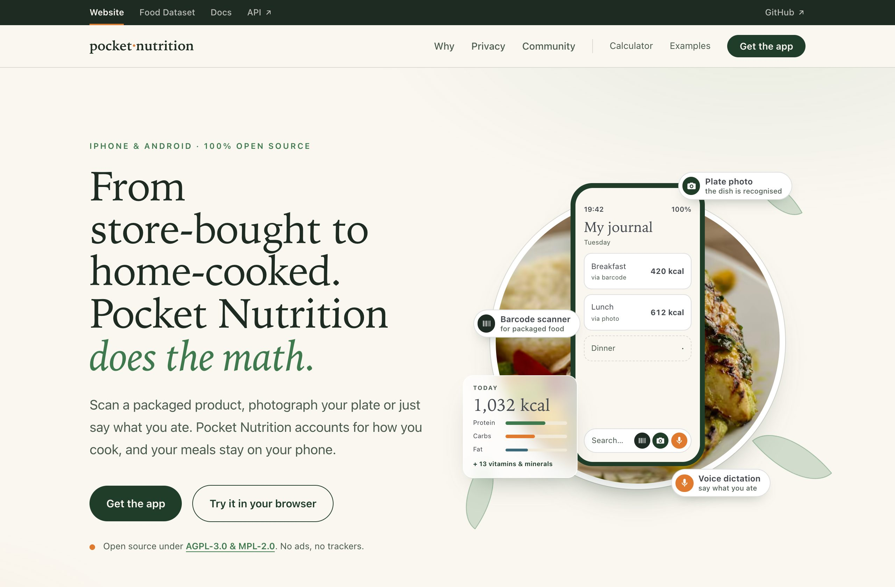
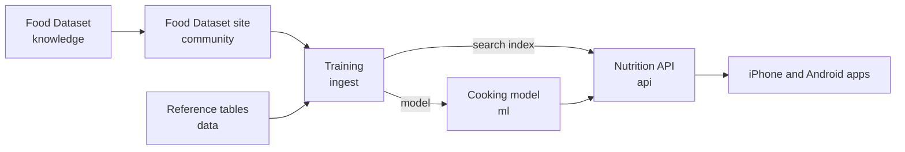

<p align="center">
  <a href="https://pocketnutrition.org">
    
  </a>
</p>

<h1 align="center">Pocket Nutrition</h1>

<p align="center">
  <strong>Nobody enjoys logging meals. So we made it fast.</strong><br>
  Open-source nutrition for iPhone and Android. It counts what cooking does to your food, and your
  journal stays on your phone.
</p>

<p align="center">
  <a href="https://pocketnutrition.org">Website</a> ·
  <a href="https://community.pocketnutrition.org">Food Dataset</a> ·
  <a href="https://pocketnutrition.org/calculator">Try it in your browser</a>
</p>

## Why Pocket Nutrition

- **Fast to log.** Search, say what you ate, photograph your plate or scan a barcode. Recent meals and
  yesterday's lunch come back in one tap.
- **Cooking counted.** 100 g of raw chicken breast weighs 77 g once boiled, and rice more than doubles.
  Pocket Nutrition does that math with 566 cooking factors that anyone can check.
- **Every nutrient.** 24 nutrients, including 13 vitamins and minerals.
- **Private by design.** No ads, no tracking, and no account to search, scan and log. Your journal stays
  on your phone; the optional vault (iPhone) keeps an encrypted copy that we cannot read.
- **Yours to improve.** Report a wrong value from the app, fix it in the open Food Dataset, or run the
  whole platform on your own servers.

## Try it

- **In your browser:** the [calculator](https://pocketnutrition.org/calculator) computes the
  nutrition of a meal with the live API.
- **On your phone:** there is no store release yet. Build the [iPhone](https://github.com/pocket-nutrition/ios)
  or [Android](https://github.com/pocket-nutrition/android) app from its source.
- **On your own servers:** [`static/self-hosting/`](static/self-hosting/) holds a Docker Compose file and a settings
  example that run the Nutrition API and the Food Dataset.

## How it fits together



| Repository | What it is |
| --- | --- |
| [ios](https://github.com/pocket-nutrition/ios) | The iPhone app (SwiftUI) |
| [android](https://github.com/pocket-nutrition/android) | The Android app (Jetpack Compose) |
| [knowledge](https://github.com/pocket-nutrition/knowledge) | The Food Dataset: 3,458 ingredients with their portions, cooking factors and links to Ciqual, USDA and McCance & Widdowson, as YAML files |
| [knowledge-editor](https://github.com/pocket-nutrition/knowledge-editor) | A desktop app to edit the Food Dataset and prepare a pull request |
| [community](https://github.com/pocket-nutrition/community) | The site to browse the Food Dataset |
| [api](https://github.com/pocket-nutrition/api) | The Nutrition API the apps call |
| [ml](https://github.com/pocket-nutrition/ml) | The model that predicts what cooking does to nutrients |
| [data](https://github.com/pocket-nutrition/data) | Loads the public reference tables: Ciqual, USDA, McCance & Widdowson, Open Food Facts |
| [ingest](https://github.com/pocket-nutrition/ingest) | Trains the model and builds the search index |
| [contracts](https://github.com/pocket-nutrition/contracts) | The API contract the apps share |
| This repository | The website and its documentation |

Not public yet: the vault, the voice and photo recognition service, and the vault's web viewer.

## Contribute

- **Spotted a wrong value?** Tap Report on the ingredient in the app: it goes straight to the team.
- **Fix the data yourself.** Add a food, link it to its scientific source or correct a portion with the
  [Knowledge Editor](https://github.com/pocket-nutrition/knowledge-editor), then open a
  pull request on [knowledge](https://github.com/pocket-nutrition/knowledge).
- **Improve the code.** Each repository has its own `CONTRIBUTING.md`; this one's is
  [here](CONTRIBUTING.md).
- **Questions and ideas:** open an issue in this repository.

## This repository

The website, [pocketnutrition.org](https://pocketnutrition.org), built with [Docusaurus](https://docusaurus.io/).

| Path | What it is |
| --- | --- |
| `src/pages/` | One file per page: homepage, calculator, examples, privacy policy |
| `src/components/` | The homepage sections, and the header and footer every Pocket Nutrition site shares |
| `src/sandbox-app/`, `src/examples-app/` | The calculator and the examples (React and Tailwind) |
| `static/self-hosting/` | The Docker Compose file and settings example for running the platform yourself |

```bash
npm ci
npm start        # http://localhost:3000
npm run build    # fails on broken internal links
```

## License

The platform, this repository included, is under [AGPL-3.0](LICENSE); the apps are under MPL-2.0. Each
repository carries its own license file.

The homepage dish photo (`static/img/hero/plate-dish.*`, also in the screenshot above) is not covered
by the AGPL: it comes from Unsplash (`https://images.unsplash.com/photo-1762631934518-f75e233413ca`)
under the [Unsplash License](https://unsplash.com/license).

If Pocket Nutrition is useful to you, a star on this repository helps others find it.

Made with ♥ from France.
