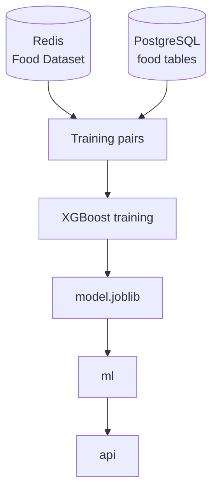

# Training the cooking model

The cooking model answers one question: given a food's raw nutrition, its food group and a
cooking method, what are its values once cooked? `ingest` trains it from
[the data sources](./data-sources.md), and `ml` serves it to the Nutrition API.

## The steps

1. **Training pairs.** For each cooking relationship, `ingest` builds a pair: the ingredient's
   raw reference values, and the cooked values derived from them (see below). When an ingredient
   has no yield for a cooking method, it gets the typical yield of its food group. The pairs are
   stored in PostgreSQL, in `training_pairs`, where the Food Dataset site shows them.
2. **Training.** An XGBoost model learns to predict the cooked values from the raw values, the
   cooking method and the food group. Optuna first tries several settings: `OPTUNA_TRIALS`, 20 by
   default. Each nutrient learns only from the pairs where it was measured.
3. **Result.** Training produces a single file, `model.joblib`, which `ml` loads into memory when
   it starts.

## How the cooked values are made

The food tables measure many foods both raw and cooked. Today a cooking relationship keeps only
the yield, worked out from the energy of the two entries, and the training pair rebuilds the
cooked values from the raw ones: for 100 g of raw food, each nutrient keeps its raw value
multiplied by a generic retention factor, and the water changes with the yield. The other
measured cooked values are not used yet. Pairs that rely on a food group's typical yield count
half as much in training.

The yields come from three kinds of source:

- About a quarter are measured, from the USDA Cooking Yields for Meat and Poultry.
- A few were entered by hand.
- The rest, about three quarters, are estimated from the energy of matching raw and cooked
  entries in the food tables.

Better yields and retention factors improve the model directly:
[Improve the Food Dataset](../contribute/food-dataset.md) explains how to propose them.

## Limits of this design

- **Little data.** About 570 cooking relationships cover about 3,500 ingredients. Each nutrient
  learns from a few hundred pairs at most, so most foods are predicted from their neighbours.
- **Measured cooked values are not used beyond energy.** The training targets are rebuilt from
  the raw values, so the model mostly learns that calculation back. It cannot learn what only the
  measurements show, such as fat lost on the grill or oil absorbed when frying.
- **Coarse inputs.** The model knows five cooking methods and six food groups: meat, fish,
  shellfish, vegetable, cereal and dairy. Legumes, eggs, fruit and the other groups share a single
  "other" group. Cooking time is accepted by the API but not used.
- **Light training.** Optuna tries 20 settings by default, and the final check holds back a tenth
  of the pairs. That suits a dataset of this size, not a fine-tuned model.
- **Fixed guardrails.** After the prediction, `ml` applies hand-set limits: carbohydrates never
  exceed the raw value, fat on lean foods is capped per cooking method, sodium is capped, and
  energy is recomputed from the macronutrients when the two disagree too much. These thresholds
  are rules of thumb, not measurements: they keep values plausible, but they can also hide what
  the model gets wrong.
