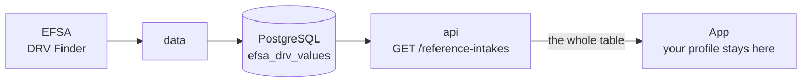

# Daily targets

Daily targets show each day of your journal against what you should eat: energy, protein, fibre,
vitamins and minerals. They are off by default in the apps: turn on **Daily targets (preview)** in
the settings to try them.

## Where the values come from

The targets start from the **Dietary Reference Values of EFSA**, the European Food Safety
Authority, as published in its [DRV Finder](https://multimedia.efsa.europa.eu/drvs/index.htm).
For each nutrient, EFSA gives values by age, sex and situation: pregnancy, breastfeeding,
physical activity level for energy, menopause for iron.

1. **`data`** downloads the table and stores it in PostgreSQL, replacing the previous copy.
2. **The Nutrition API** serves the whole table at `GET /reference-intakes`, tagged with the
   journal's nutrient names.
3. **The app** picks the values that match your profile and computes your targets.

## Your profile stays on your phone

`GET /reference-intakes` takes no parameter: every app downloads the same table. Your age, sex,
weight or pregnancy are never sent to the server; the app does the selection itself.

## What is compared, and what is not

A value is matched to a journal total only when both measure the same thing. Some EFSA values
are served without a match on purpose:

- **Energy in megajoules, niacin per megajoule, vitamin A in retinol equivalents**: different
  units from the journal's.
- **Added and free sugars**: the journal counts total sugars.
- **Water**: the journal only sees the water in food, not drinks.

Values expressed as a share of energy or per kilogram of body weight are kept: the app converts
them with your own energy target or weight.
