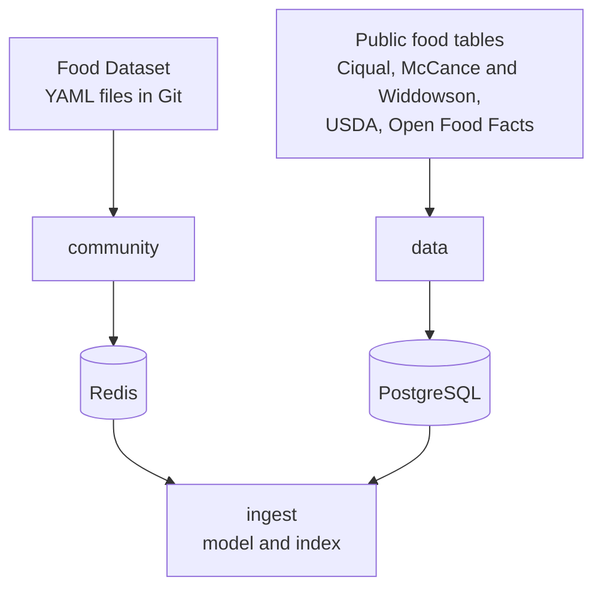

# Where the data comes from

Two sources feed Pocket Nutrition. The **Food Dataset** is curated by the community, and the
**public food tables** are published by food agencies. Each lands in its own store, from which
[the cooking model](./cooking-model.md) is trained and [the search index](./search-index.md) is
built.

## The Food Dataset

The Food Dataset is a Git repository of YAML files,
[pocket-nutrition/knowledge](https://github.com/pocket-nutrition/knowledge):

| Folder | One file per | Order of magnitude |
| --- | --- | --- |
| `ingredients/` | Ingredient: names in English and French, food group, portions, density, units | Thousands |
| `source_mappings/` | Link between an ingredient and an entry of a public food table, with a confidence | Thousands |
| `cooking_relationships/` | Ingredient and cooking method: its yield, often with retention factors | Hundreds |
| `recipes/` | Recipe: ingredients with their weights and cooking methods | A handful |

Training reads the whole Food Dataset from Redis, and `community` keeps that Redis filled: when it
starts, it downloads the repository and loads every file into it. The Food Dataset site reads the
same copy. Redis holds nothing but this copy, so it needs no backup: a restart rebuilds it.

## The public food tables

`data` downloads one table per run and loads it into PostgreSQL:

| Loader | Source | Version |
| --- | --- | --- |
| `ciqual` | Ciqual, by ANSES (France) | 2025 |
| `mccance` | McCance and Widdowson's Composition of Foods (UK) | 2021 integrated dataset |
| `usda` | USDA FoodData Central, survey foods (FNDDS) | October 2024 |
| `usda_foundation` | USDA FoodData Central, Foundation Foods | October 2024 |
| `usda_sr` | USDA SR Legacy | April 2018 |
| `usda_cooking_yields` | USDA Cooking Yields for Meat and Poultry | Release 2 |
| `off` | Open Food Facts, packaged products | Latest export |

The food tables give the reference values the model trains on. Open Food Facts products are not
trained on: they are copied into the search index as they are.

`data` also loads the EFSA reference intakes, which have nothing to do with this chain: see
[Daily targets](./daily-targets.md).

## Who does what

| Component | Responsible for | Reads | Writes |
| --- | --- | --- | --- |
| `community` | Serving the Food Dataset | The Food Dataset, and PostgreSQL for its site | Redis |
| `data` | Loading the public food tables | Public food tables | PostgreSQL source tables |
| `ingest` | Training the model and building the search index | Redis, PostgreSQL source tables | Training pairs, model file, search index |
| `api` | Answering nutrition requests | Search index, PostgreSQL | Its own tables: feedback and votes |
| `ml` | Predicting the effect of cooking | Model file | Nothing |

Everything a job writes is rebuilt from what it reads, so a wrong value is fixed in the Food
Dataset, and the next training picks it up. For example:

- **A yogurt shows the values of a cheese:** its link points to the wrong entry of a food table.
- **Grilled chicken comes out too light in calories:** its yield for grilling is off.

## When each job runs

- **`community`** loads the Food Dataset at every start, and on reload.
- **`data`** runs once when you install, then whenever a source publishes a new release.
- **`ingest`** runs after the Food Dataset or a table changes.

[Set up a training bench](../self-hosting/training-bench.md) gives the commands.

## Invariants

- **Identifiers are ASCII slugs**, such as `chicken_breast`, made by the same function in the
  training pipeline and in the API.
- **The 24 nutrients are fixed.** The same list runs through the loaders, the training pairs, the
  model, the index and the API.
