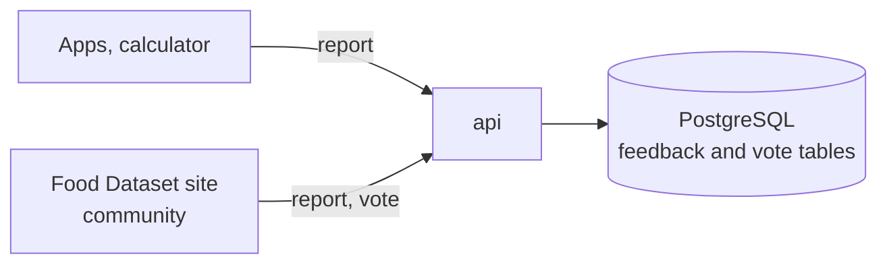

# Feedback and votes

Users can say when a food looks wrong. This page draws the boundary of that feature: what is
collected, where it goes, and what it never touches.

## What users can send

- **A report**, with **Report** on an ingredient in the apps, on the Food Dataset site or in the
  calculator. It holds one or more corrections, each in a category (nutrition, name and identity,
  portions and units, cooking, other) with an optional proposed value, and an optional comment.
- **A vote**, up or down, on the Food Dataset site: on the link between an ingredient and a food
  table entry, or on a cooking factor.

No account is needed for either.

## Where it is stored

The Nutrition API owns these tables and is the only one to write them; the Food Dataset site
sends its reports and votes through the API. They sit apart from the [data sources](./data-sources.md):
nothing in them reaches the Food Dataset, the cooking model or the search index on its own.

## What is kept, and what is public

| Kept | Public |
| --- | --- |
| The corrections and the comment, the ingredient, where the report came from | Yes, per ingredient, at `GET /feedback` |
| A salted hash of the sender's IP address, when the server has a salt set; never the address itself | No |
| The browser or app version (user agent) | No |
| The count of up and down votes | Yes, on the Food Dataset site |

## How a report becomes a fix

This part is still basic. Nothing uses reports or votes automatically: a maintainer reads them and
turns the valid ones into a change through the usual pull request, as described in
[Improve the Food Dataset](../contribute/food-dataset.md). Nothing marks a report as handled, and
votes only point to what to check first.

Two constraints shape how reports can be put to use:

- **A fix goes into the source data.** What users see is generated from the Food Dataset and the
  food tables by [training](./cooking-model.md). A value corrected where it is displayed would be
  overwritten by the next training, so a report always leads to a change in the Food Dataset.
- **An anonymous report cannot be weighed.** Reports and votes are not tied to a user. A useful
  correction therefore looks the same as one from a bot or a careless click, and there is no way
  to trust regular contributors more than unknown ones.
