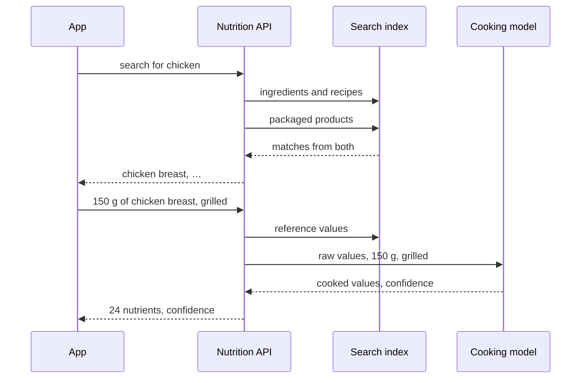

# Life of a nutrition request

Logging a food takes two calls to the Nutrition API: one to find the food, one to compute its
nutrition. This page follows both calls. Every endpoint is described in the
[API reference](https://api.pocketnutrition.org/swagger-ui/index.html).



## 1. Finding the food

```http
GET /ingredients/search?q=chicken&lang=en&limit=10
```

The search index holds three kinds of document:

- **Ingredients** from the Food Dataset. An ingredient is indexed only when it links to at least
  one public food table. Without reference values, the API would have nothing to compute.
- **Recipes**, made of indexed ingredients.
- **Packaged products** from Open Food Facts, when they have been loaded.

Each search runs two queries, one over ingredients and recipes and one over products. Then it
builds the list: ingredients first, with a few places kept for products. Products get a fifth of
the list, and always at least two places, so a search for "nutella" still finds the jar. When
one side finds nothing, the other side fills the whole list. Without this split, a common word
like "chicken" would return only packaged products, because thousands of them are named
"Chicken".

Labels match while you type, tolerate typos, and prefer the language you ask for. You can type
several foods at once, with spaces: `rice chicken broccoli` returns the best match for each. The
API splits the words into the longest names it knows, so `pomme de terre` (potato) stays one food
rather than three, and it also searches the whole phrase, so a product named exactly what you
typed comes first. Commas or semicolons force the split: `rice, chicken, broccoli`.

**Barcodes.** `GET /ingredients/barcode/{ean13}` looks the product up in the same index. The
API never calls Open Food Facts while you scan. It finds a product only if that product was in the
Open Food Facts data loaded before the index was built.

## 2. Computing the nutrition

```http
POST /nutrition
Content-Type: application/json

[{"ingredientId": "chicken_breast", "name": "chicken breast", "quantity": 150, "unit": "g",
  "cookingMethod": "grilled", "measuredState": "raw"}]
```

The body is a list, and each food in it goes through these steps:

1. **Identify the food.** The app sends the ID it got from the search. If a request carries only
   a name, the API looks for an ingredient with that exact label, then for a close one.
2. **Convert to grams.** Grams stay as they are. `item` uses the ingredient's usual portion: one
   chicken breast counts as 150 g. Millilitres use a density when the API knows one, and 1 g per
   ml otherwise.
3. **Answer packaged products from their label.** The values printed per 100 g are scaled to the
   portion. The source is `off_direct` and the confidence is 1. Open Food Facts gives seven
   values: energy, protein, fat, carbohydrates, sugars, fibre and sodium. The other nutrients stay
   empty. The cooking method is ignored, because the model has never seen an industrial product.
4. **Send ingredients to the cooking model,** one request per food, with the ingredient's
   reference values read from the index.

### Where reference values come from

Reference values are computed when the search index is built, from the public food table entries
the ingredient links to. Raw entries come first. Some foods only have a dry entry, the state they
are sold in (pasta, lentils, spices): the dry entry is then used instead, as the food's
uncooked state. When an ingredient links to several entries, for
example in Ciqual and in USDA, each nutrient takes the median of their values, weighted by the
confidence of each link. [Where the data comes from](./data-sources.md) shows the whole chain.

## 3. What cooking changes

The cooking model works per 100 g of raw food.

- **`raw` skips the model.** The reference values are scaled to the weight, and that is the
  answer.
- **Cooked foods go through the model.** From the raw values, the cooking method and the food
  group, it predicts all 24 nutrients. It knows five methods: boiled, steamed, grilled, roasted
  and fried. With `cooked`, which means the method is unknown, it predicts without one. It knows
  six food groups out of the Food Dataset's 21: cereal, dairy, fish, meat, shellfish and
  vegetable.

The prediction then goes through a few physical checks:

- Cooking cannot create carbohydrates. The predicted value never exceeds the raw value.
- Lean foods (under 5 g of fat per 100 g) cannot gain much fat. For animal foods, the cap is 4
  times the raw fat when fried, 2.3 times when grilled or roasted, and 1.5 times when boiled or
  steamed. Lean vegetables and cereals cannot gain more than 10% protein or fat.
- Vegetables and cereals contain no cholesterol and no vitamin B12.
- Sodium cannot grow beyond 1.5 times the raw value, so salt added while cooking is not counted.
- Energy must agree with the macronutrients, at 4 kcal per gram of protein and of carbohydrate,
  9 per gram of fat and 2 per gram of fibre. When the predicted energy is more than 40% away from
  that figure, it is replaced by it.

**Food weighed after cooking.** Cooking changes the weight, so the API first works out the raw
weight with the [yield](../glossary.md#yield): 150 g of grilled chicken with a yield of 0.75 came from
200 g of raw chicken. It uses the ingredient's yield for that method, then its yield for
"cooked", then the typical yield of its food group. With no yield at all, the cooked weight is
used as if it were raw, and the confidence drops.

## 4. Confidence and availability

Every result carries a `confidence` between 0 and 1, and an `available` flag.

- **1** for a packaged product read from its label, a raw ingredient, or a cooked ingredient with
  a known method and, if it was weighed cooked, a known yield.
- **Multiplied by 0.8** when the method is unknown (`cooked`), and again when a cooked weight has
  no yield.
- **`available` is false** when the confidence is below 0.6, or when the food has no reference
  values. The source is then `unavailable` and the numbers should not be used.

## 5. The answer

Each food comes back with the fields of the request, then:

- **The 24 nutrients** for the quantity asked: energy, protein, fat (saturated, monounsaturated
  and polyunsaturated), carbohydrates, sugars, fibre, water and cholesterol, plus 13 vitamins and
  minerals. Those are sodium, potassium, calcium, magnesium, phosphorus, iron, zinc and vitamins A
  (as retinol), B6, B12, C, D and niacin.
- **`confidence`** and **`available`**, as above.
- **`source`**: `ml` for the cooking model, `off_direct` for a product label, `unavailable` when
  there is no answer.

The list keeps the order of the request. A result cache exists in the code, but it is switched
off: every request is computed from scratch.
