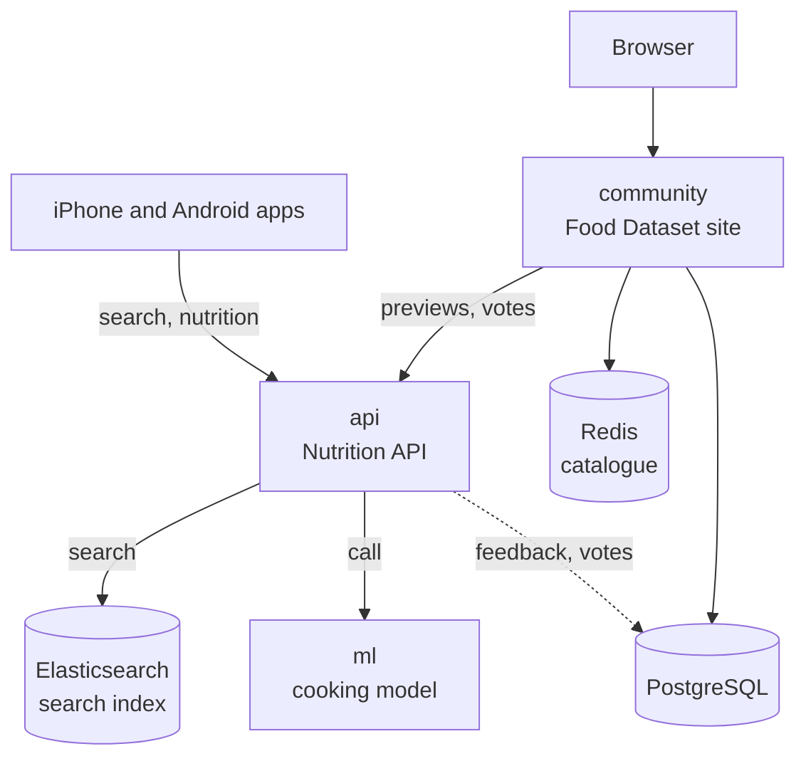
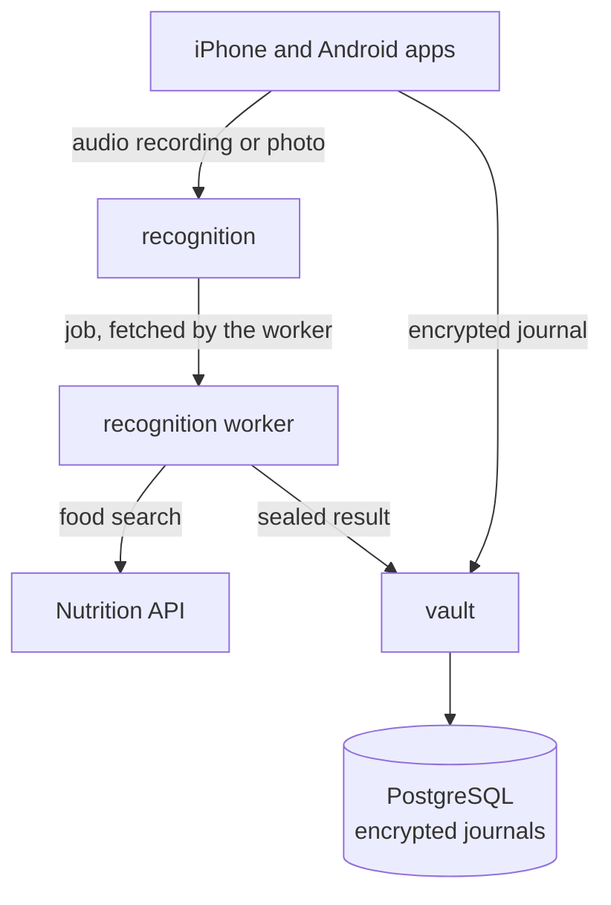

# System overview

Pocket Nutrition is a set of small programs, each with one job. This page lists them, shows how
they connect, and names the principles they follow. [How it works](../how-it-works.md) tells the
same story with less detail.

## At runtime

The apps talk to three services, each on its own address: the Nutrition API, the vault and the
recognition server. Only the Nutrition API is needed to search foods and log meals.

### The nutrition platform

### Optional services

The vault and voice and photo are optional, and the apps can point each one at another server.
The recognition worker makes only outgoing connections. It asks the recognition server for work,
so the computer it runs on accepts no incoming connection.

## Components

| Component | What it does | Source |
| --- | --- | --- |
| **Nutrition API** (`api`) | Answers the apps: food search, barcodes, nutrition, reference intakes. Kotlin and Spring Boot. | [api](https://github.com/pocket-nutrition/api) |
| **Cooking model** (`ml`) | Predicts what cooking does to an ingredient. Python, FastAPI and XGBoost. It reads one model file when it starts and never queries a database. | [ml](https://github.com/pocket-nutrition/ml) |
| **Food Dataset** | The ingredient catalogue as YAML files: ingredients, links to public food tables, cooking relationships and recipes. | [knowledge](https://github.com/pocket-nutrition/knowledge) |
| **Food Dataset site** (`community`) | Loads the catalogue into Redis at start and serves the site to browse it. Python and FastAPI. | [community](https://github.com/pocket-nutrition/community) |
| **Knowledge Editor** | A desktop app to edit the catalogue without touching YAML. Tauri and React. | [knowledge-editor](https://github.com/pocket-nutrition/knowledge-editor) |
| **Reference loader** (`data`) | A one-shot job that downloads public food tables into PostgreSQL. | [data](https://github.com/pocket-nutrition/data) |
| **Training pipeline** (`ingest`) | A one-shot job that trains the cooking model and builds the search index. | [ingest](https://github.com/pocket-nutrition/ingest) |
| **Shared contract** | What both apps must agree on: the API schema, design tokens, wording and shared test cases. | [contracts](https://github.com/pocket-nutrition/contracts) |
| **iPhone app** | SwiftUI. | [ios](https://github.com/pocket-nutrition/ios) |
| **Android app** | Jetpack Compose. | [android](https://github.com/pocket-nutrition/android) |
| **Vault** (`vault`) | Stores end-to-end encrypted journals. It never holds the keys to read them. See [The encrypted vault](./vault.md). | [vault](https://github.com/pocket-nutrition/vault) |
| **Recognition server** (`recognition`) | Queues recordings and photos until a worker takes them. It keeps everything in memory. | [recognition](https://github.com/pocket-nutrition/recognition) |
| **Recognition worker** | Turns a recording or a photo into a list of foods, on a Mac you control. | [recognition-worker-osx](https://github.com/pocket-nutrition/recognition-worker-osx) |
| **Web viewer** | Opens your vault in a browser, read-only, and decrypts it there. | [vault-web](https://github.com/pocket-nutrition/vault-web) |
| **Website** | This site, with the documentation, the calculator and the examples. Docusaurus. | [pocket-nutrition](https://github.com/pocket-nutrition/pocket-nutrition) |

The servers and the web viewer are free software under the AGPL-3.0. The mobile apps, and the
contract they share, are under the MPL-2.0.

## Where data lives

| Store | What it holds | Written by | Read by |
| --- | --- | --- | --- |
| **Your phone** | Your journal | the app | the app |
| **Elasticsearch**, index `product_search` | Ingredients, recipes and packaged products, with their reference values | `ingest` | `api` |
| **PostgreSQL** | Public food tables, training pairs, reference intakes, feedback and votes | `data`, `ingest`, `api` | `ingest`, `api`, `community` |
| **Redis** | The catalogue, rebuilt from the Food Dataset at every start | `community` | `ingest` |
| **Model file** `model.joblib` | The trained cooking model | `ingest` | `ml` |
| **Vault database** | Accounts and encrypted journals | `vault` | `vault` |
| **Recognition server memory** | Recordings and photos, until a worker is done with them, 48 hours at most | `recognition` | `recognition` |

Elasticsearch, Redis and the model file can all be rebuilt from the Food Dataset and the public
food tables. The journals are different. They exist only on phones and, encrypted, in vaults.

## Official services

| Address | Service |
| --- | --- |
| `api.pocketnutrition.org` | Nutrition API |
| `community.pocketnutrition.org` | Food Dataset site |
| `vault.pocketnutrition.org` | Vault |
| `recognition.pocketnutrition.org` | Recognition server |
| `me.pocketnutrition.org` | Web viewer |
| `pocketnutrition.org` | Website and these docs |
| `status.pocketnutrition.org` | Service status |

## Principles

- **Data flows one way.** The Food Dataset feeds Redis, the public tables feed PostgreSQL, and
  training reads both to produce the model and the search index. Nothing writes back upstream.
  [Where the data comes from](./data-sources.md) explains why.
- **The apps hold no nutrition data.** They never embed food tables or reference values. Every
  number comes from the Nutrition API, so fixing a value on the server fixes it in every app.
- **Prediction is stateless.** The cooking model receives everything it needs with each request,
  and its answers depend only on the model file.
- **Your journal belongs to your phone.** It works without an account. The vault keeps a copy
  that only your devices can decrypt.
- **Each service sees only what its job needs.** Keeping the journal and processing new entries
  are separate jobs. The [vault](./vault.md) stores the whole journal but cannot read it. The
  recognition worker reads one recording or photo at a time, never the journal, and writes its
  result into the vault, sealed for your phone. A tool added later follows the same rule: it can
  write into the vault without being able to read it.
- **The API stays backward compatible.** The apps ship through the app stores, so many installed
  versions talk to the same server, and they update on their own schedule, not when the server
  does. A server update must therefore keep working with the apps already installed: the API never
  removes or renames a field, it only adds new ones. There is no way today for the server to tell
  an app that it is too old, so a breaking change would simply make older apps fail.
- **Every server can be self-hosted.** Each one runs on your own machine, and the apps let you
  point each service at your own address. See [Self-hosting](../self-hosting/overview.md).
