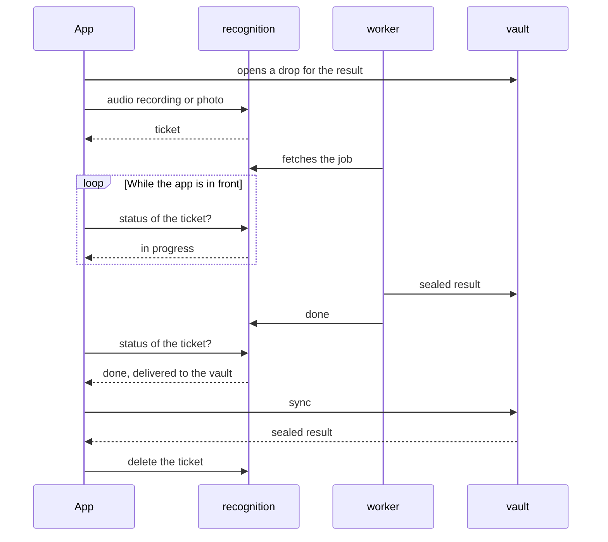

# Life of an audio recording or photo

When you log a meal by voice or photo, the recognition does not run on the phone or on the
recognition server: a worker does it, in the background, and it can take a while. This page
follows one recording or photo from start to finish.

## 1. Sending

The app first opens a drop in your vault: a write-only place for this one result (see
[The encrypted vault](./vault.md#outside-tools-writing-without-reading)). It then sends the
recording or photo to the recognition server, with the details of that drop, and gets a ticket
back. Without a vault, nothing is sent.

## 2. Waiting for a worker

The recognition server keeps the recording or photo in memory, never on disk, and processes
nothing itself. A worker asks it for work, takes the job and must report progress at least every
two minutes. If it does not, the job goes back in the queue; after three attempts it ends as a failure. A job
nobody takes expires after 48 hours.

## 3. Recognition

The worker turns the recording or photo into a list of foods, using the Nutrition API to find
them. It seals the result for your phone, puts it in the drop, then tells the recognition server
the job is done. The server forgets the recording or photo as soon as the job ends, done or
failed.

## 4. Collecting

Once the ticket says done, the result is already in the vault. The app fetches it at its next
sync, opens it, saves it to the journal, then deletes the ticket on the recognition server.

## Why the app asks instead of being notified

The servers have no tie to a notification service: none of them knows how to reach a phone, and
none goes through Apple's or Google's push services. That keeps a self-hosted server as simple to
run as the official one.

So the app finds out by itself that a result is ready. While it is open, it asks the recognition
server about each recording or photo still in progress, and the server answers as soon as the
status changes. When the app is closed, it asks nothing: the work goes on, and the result is
waiting the next time it opens.

The downside: nothing tells you that a result is ready. It shows up when you open the app.
