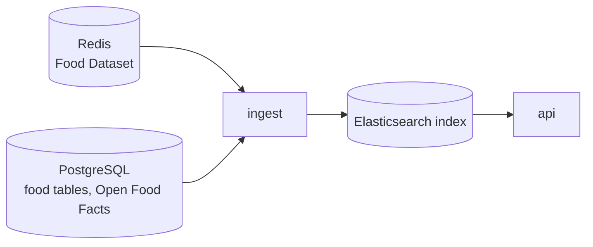

# The search index

Every search in the apps, and every barcode scan, is answered from one Elasticsearch index. It is
built for speed: results as you type, with room for typos. How best to fill and query it is still
being explored.

## What goes into it

`ingest` writes one entry per searchable item:

- **Ingredients** from the Food Dataset, with their names in each language, portions, units,
  food group, yields and reference values. Only ingredients linked to at least one food table
  entry are indexed: without reference values, there is nothing to compute.
- **Recipes** from the Food Dataset.
- **Open Food Facts products**, as they are: name, brand, barcode, photo and the values printed
  on the label.

## What the API uses it for

- **Search as you type** (`GET /ingredients/search`): matching foods with their nutrition.
- **Barcode lookup** (`GET /ingredients/barcode/{ean13}`): one product, by its barcode.
- **Nutrition**: the raw reference values and the food group the cooking model starts from.

## Rebuilt without downtime

Each run fills a new index from scratch. When it is complete, the alias `product_search` moves to
it in one step and the old index is deleted, so the API keeps answering during the rebuild.
