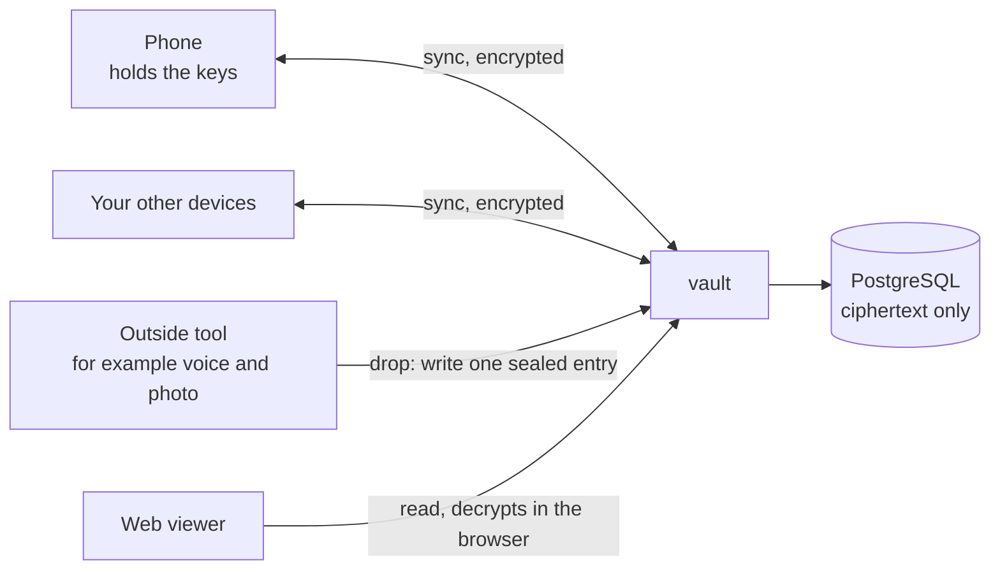

# The encrypted vault

The journal lives on your phone. The vault is an optional server that keeps an end-to-end
encrypted copy of it: your devices encrypt every entry before sending it, and the server never
holds the keys to read it. It is a separate service with its own database, and it can be
[self-hosted](../self-hosting/host-the-vault.md).

## A mirror of the phone

Each journal entry is a record, encrypted on the device with your user key. The vault numbers
every write, and a device asks for everything newer than the last number it saw: that is the whole
synchronisation. Several devices can be linked to the same account; each pulls the others' changes
the same way.

When two devices change the same record, the second write is refused and that device merges the
two versions itself, since only the devices can read them. Deleted records leave a marker for 90
days, so that every device hears about the deletion.

The server sees only what it needs to store and order the records: how many there are, their
sizes and dates, and a coarse type such as "meal". Never their content.

## Outside tools: writing without reading

Some tools need to put a result in your journal: today the
[voice and photo worker](./overview.md), tomorrow perhaps a tool that prepares recipes or brings in
information from elsewhere. The vault lets them write without giving them any way to read.

- **The phone opens a drop.** It asks the vault for a drop token for one new record: write-only,
  valid for a few days at most and for a few writes.
- **The tool seals its result.** It encrypts the result to the phone's inbox key, a public key
  whose private half only your devices hold, and deposits it with the drop token. The token can do
  nothing else: no reading, no listing, no other record.
- **The phone takes it in.** On its next sync it opens the sealed result and saves it as a normal
  journal entry, encrypted with your user key.

The tool never sees the journal, and cannot even read back what it wrote. The same mechanism
works for any outside tool, as long as the phone opens the drop.

The vault also supports the opposite direction: giving a reader its own read-only access to one
part of the data, sealed to the reader's key and revocable at any time. No app uses it yet.

## Signing in: the phone holds the keys

An account belongs to one vault and is identified by a username: no email address is stored.

- **Your passphrase never leaves the device.** The device derives two keys from it: one proves who
  you are to the server, the other unlocks your user key. The server stores the first in a form it
  cannot reverse, and never receives the second.
- **Each device gets its own key** when it links. A lost phone can be unlinked alone, from any
  other device.
- **Linking a new device** takes the username and the passphrase: the device downloads your keys,
  still locked, and unlocks them itself.
- **Two-factor login** is optional, per account. It asks for a code from an authenticator app when
  a new device links. Devices already linked keep working.
- **Wrong passphrases** lock new logins to the account for 15 minutes after five attempts.

The server only decides who may connect. The vault's owner chooses whether anyone can create an
account or only accounts created by an administrator, and sets the storage allowed per account:
see [Host your vault](../self-hosting/host-the-vault.md).

## A forgotten passphrase

The server cannot reset a passphrase: it never had the keys. A linked phone can, because it holds
them. It sets a new passphrase and a new recovery key, behind the phone's own lock (Face ID or the
device code). The other devices and the web viewer are logged out and log in again with the new
passphrase. Nothing is re-encrypted.

At account creation, the app shows an emergency kit with the passphrase and a recovery key, to keep
outside the phone. Without the passphrase and without any linked device, the data cannot be
recovered.

## Getting your data out

- **The web viewer** opens the vault in a browser, decrypts it there, and exports the journal as
  a CSV file.
- **Erasing the account** removes everything stored for it on the server.
- **Changing vault** means logging in to another one. The data does not move by itself: it can only
  be decrypted on a device, so a move has to go through one.
