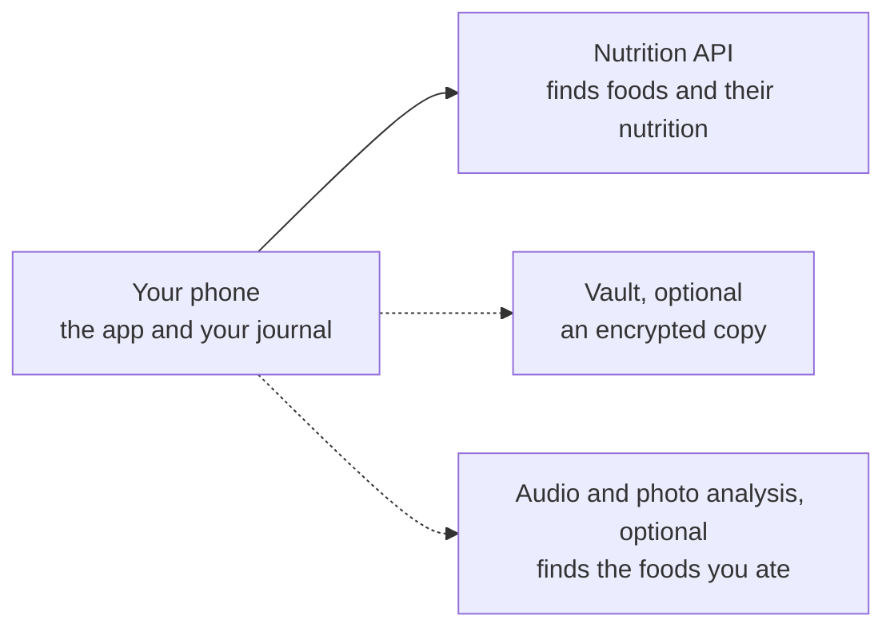

# How it works

Pocket Nutrition is a meal journal for iPhone and Android: you log what you eat, and it tells you
what it contains. Your journal stays on your phone. The app relies on a few services, which you
can also host yourself.

## Logging a meal

| You… | What happens | Go deeper |
| --- | --- | --- |
| Type a food | The Nutrition API finds it, then computes its nutrition for your portion and cooking method. | [Life of a nutrition request](./architecture/nutrition-request.md) |
| Scan a barcode | The API returns the values printed on the product's label, from Open Food Facts. | [The search index](./architecture/search-index.md) |
| Say it or photograph your plate | A worker turns it into a list of foods, which you confirm before they are added. | [Life of an audio recording or photo](./architecture/recognition.md) |

Whichever way you use, the meal is saved on your phone. Searching, scanning and logging need no
account.

## Where the numbers come from

The public food tables, published by food agencies such as ANSES in France, are written for
science: one entry per food in one precise state, such as "chicken, breast, meat only, raw", with
values per 100 g. Logging a meal needs something else: the name you would type, the portion you
eat, raw or cooked. The **Food Dataset** bridges the two. It defines the ingredients you log, with
their portions and cooking factors, and links each one to the table entries that describe it. All
of this is prepared ahead of time, so the app only looks up the result.

:::info[Still a work in progress]
Many ingredients lack a link to a table, and most cooking factors are estimates. The method relies
on a community that corrects the data and fills in what is missing:
[Improve the Food Dataset](./contribute/food-dataset.md).
:::

- [Where the data comes from](./architecture/data-sources.md): the tables, the Food Dataset and how they are combined.
- [Training the cooking model](./architecture/cooking-model.md): how cooking is predicted, and its limits.
- [Daily targets](./architecture/daily-targets.md): the reference intakes from EFSA.

## Your data

- **Your journal stays on your phone.** There are no ads, no trackers and no analytics.
- **The vault** keeps an encrypted copy that only your devices can read:
  [The encrypted vault](./architecture/vault.md).
- **A recording or photo** is kept by the server only until a worker has turned it into foods,
  and the result goes to your vault, sealed for your phone:
  [Life of an audio recording or photo](./architecture/recognition.md).

## Go further

- [System overview](./architecture/overview.md): every component, store and connection.
- [Self-hosting](./self-hosting/overview.md): run every service on your own server.
- [Glossary](./glossary.md): the words these pages use.
